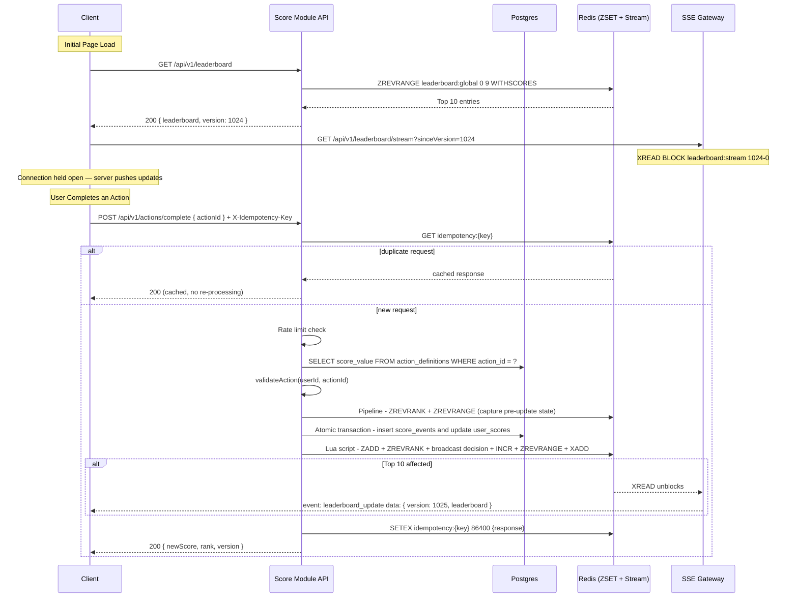
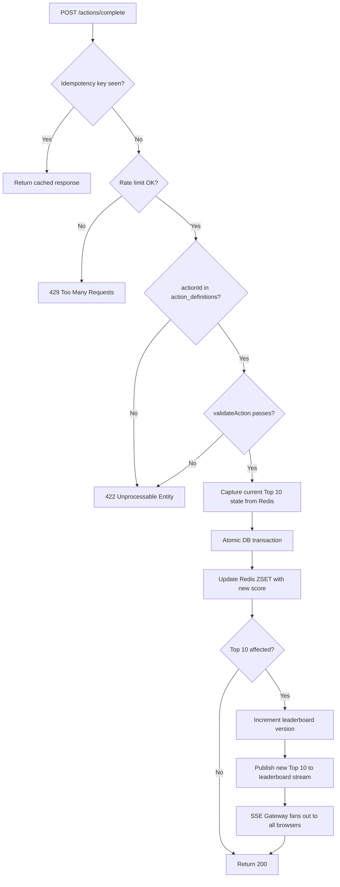

# Scoreboard Live Update Module — Backend Specification

**Version:** 1.0.0

**Status:** Ready for Implementation

**Date:** 2026-10-16

---

## 1. Overview

### 1.1 Purpose

Build a secure, real-time scoreboard module that displays the top 10 users by score. The module handles score updates triggered by user actions, prevents unauthorized score manipulation, and pushes live updates to all connected clients.

### 1.2 Core Rule

> **Never trust the client.** The client sends only `actionId`. The server looks up the canonical score value and applies it. The client never sends a score delta.

### 1.3 Scope

**In scope:**
- Score submission API
- Score validation and authorization
- Leaderboard aggregation (Top 10)
- Real-time broadcast via Server-Sent Events (SSE)
- Persistence (Postgres + Redis)

**Out of scope:**
- What the "action" is — action validation logic is provided by the game/business logic layer
- Frontend rendering
- User authentication system (we integrate with it via `Authorization: Bearer <jwt>`)

---

## 2. Architecture

### 2.1 Services

The module is split into two independently deployable services:

| Service | Responsibility | Scaling axis |
|---|---|---|
| **Score Module API** | Handles score submissions, leaderboard reads, DB writes, Redis ZSET updates | CPU + DB throughput |
| **SSE Gateway** | Maintains long-lived browser connections, fans out leaderboard broadcasts | Memory + open file descriptors |

They are decoupled via Redis Stream — the Score Module writes to it, the SSE Gateway reads from it. Neither service calls the other directly.

```
[Client]
   │
   ├── GET  /api/v1/leaderboard         ──► [Score Module API] ──► [Postgres]
   │                                               │                    │
   ├── POST /api/v1/actions/complete    ──► [Score Module API] ──► [Redis ZSET]
   │                                               │
   │                                          XADD to [Redis Stream]
   │                                               │
   └── GET  /api/v1/leaderboard/stream  ──► [SSE Gateway] ◄── XREAD ── [Redis Stream]
```

### 2.2 Deployment

```
Load Balancer
  │
  ├── /api/v1/leaderboard
  ├── /api/v1/actions/complete    ──►  Score Module API  (scale on CPU / write throughput)
  │
  └── /api/v1/leaderboard/stream  ──►  SSE Gateway       (scale on memory / concurrent connections)
```

Each SSE Gateway instance independently holds a `XREAD BLOCK` connection to Redis. When `XADD` is called, Redis unblocks all waiting instances simultaneously and each fans out to its own connected browsers. No sticky sessions or shared state between gateway instances are required.

### 2.3 Sequence Diagram



### 2.4 Flowchart — Score Update Decision Logic



> **Broadcast condition:** A user already in the Top 10 who gains more points changes the ordering — this must broadcast even if their new score does not exceed the current 10th-place threshold. Both conditions are evaluated before the ZADD.

---

## 3. Core Concepts

### 3.1 The `version` Field

`version` is a monotonic integer counter stored in Redis.

- **Key:** `leaderboard:version`
- **Increment:** `INCR leaderboard:version` on every Top-10 broadcast
- **Stream ID:** Each stream entry uses `<version>-0` as its Redis Stream entry ID (e.g. `1025-0`). This allows `sinceVersion` to be used directly as the XREAD cursor without any mapping.

```
# Write (Score Module)
XADD leaderboard:stream 1025-0 data <top10-json>

# Read (SSE Gateway — blocks until new entry arrives)
XREAD BLOCK 15000 STREAMS leaderboard:stream 1024-0
```

**Why Redis Streams over Pub/Sub?** Pub/Sub drops messages if the SSE Gateway restarts between a write and a read. Streams persist the entry, covering the narrow race window between a client's `GET /leaderboard` call and its SSE subscribe.

**Stream trimming:** `MAXLEN 1` — only the latest broadcast is retained. **This is an explicit design assumption: clients always see the current Top 10, not a history of every change. If multiple score updates occur while the SSE Gateway is fanning out, intermediate states are intentionally discarded — only the latest leaderboard snapshot is delivered.**

**Version recovery:** If the SSE Gateway loses its cursor (process restart), it calls `GET /leaderboard` to obtain the current version and snapshot, then resumes the stream from that point. The REST endpoint is the universal recovery path.

### 3.2 Action Validation

`validateAction` is a function inside the Score Module whose body is left for the team owning the game/business rules to implement. The Score Module calls it before applying any score — if it returns `false`, the request is rejected with `422`.

```typescript
// Implemented by the team owning game/business rules
async function validateAction(userId: string, actionId: string): Promise<boolean> {
  // e.g. check game state, session validity, action eligibility
}
```

This keeps the score submission flow decoupled from game-specific logic. The problem statement explicitly says the action itself is out of scope, so this function is a placeholder until those rules are defined.

### 3.3 Real-Time Transport: SSE

**Decision: Server-Sent Events (SSE)** is the transport for live leaderboard updates.

| | SSE | WebSocket |
|---|---|---|
| Direction | Server → Client (one-way) | Bidirectional |
| Auto-reconnect | Native (`EventSource`) | Manual |
| Proxy/firewall compatibility | HTTP/1.1 + HTTP/2 | Requires protocol upgrade |
| Complexity | Low | Higher |

The leaderboard is a one-way data feed — the server pushes, clients only receive. SSE is sufficient and simpler to operate than WebSocket.

---

## 4. API Specification

### 4.1 Authentication

All endpoints require:
```
Authorization: Bearer <user_jwt>
```

The JWT is issued by the existing Auth service. This module validates it but does not issue tokens.

### 4.2 Response Envelope

All success and error responses use `application/json` with a consistent shape.

**Success:**
```typescript
interface SuccessResponse<T> {
  data: T;
}
```

**Error:**
```typescript
interface ErrorResponse {
  error: {
    code: string;    // machine-readable constant, e.g. "RATE_LIMITED"
    message: string; // human-readable description
  };
}
```

**Example error body:**
```json
{
  "error": {
    "code": "RATE_LIMITED",
    "message": "Score submit limit exceeded. Try again in 60 seconds."
  }
}
```

---

### 4.3 `POST /api/v1/actions/complete`

Submit a completed action. The server derives the score delta from `action_definitions` — no score value is accepted from the client.

**Request:**
```
POST /api/v1/actions/complete
Authorization: Bearer <user_jwt>
X-Idempotency-Key: <uuid-v4>
Content-Type: application/json

{
  "actionId": "blackjack_win"
}
```

**Lua Script (defined once at startup):**

The broadcast block — ZADD, broadcast decision, INCR, ZREVRANGE, XADD — executes as a single atomic Lua script. This reduces 4 round trips to 1 and guarantees that no partial state is observable between the ZADD and the stream publish.

```lua
-- KEYS[1]: leaderboard:global  (ZSET)
-- KEYS[2]: leaderboard:version (counter)
-- KEYS[3]: leaderboard:stream  (Stream)
-- ARGV[1]: userId
-- ARGV[2]: newScore
-- ARGV[3]: minTop10Score (captured before DB update)
-- ARGV[4]: wasAlreadyInTop10 ('1' or '0')

local newScore     = tonumber(ARGV[2])
local minScore     = tonumber(ARGV[3])
local wasInTop10   = ARGV[4] == '1'

-- Update sorted set and retrieve new rank in one pass
redis.call('ZADD', KEYS[1], newScore, ARGV[1])
local newRank = redis.call('ZREVRANK', KEYS[1], ARGV[1])

-- Broadcast only if Top 10 is affected
local shouldBroadcast = (newScore >= minScore) or wasInTop10
if not shouldBroadcast then
  return {0, newRank}
end

-- Increment version and publish new Top 10 to stream
local newVersion = redis.call('INCR', KEYS[2])
local top10       = redis.call('ZREVRANGE', KEYS[1], 0, 9, 'WITHSCORES')
local streamId    = tostring(newVersion) .. '-0'
redis.call('XADD', KEYS[3], 'MAXLEN', '~', '1', streamId, 'data', cjson.encode(top10))

return {newVersion, newRank}
```

**Server Logic (Score Module API):**

```typescript
interface ActionDefinition {
  actionId: string;
  scoreValue: number;
  cooldownMs: number;
}

interface CompleteActionResponse {
  userId: string;
  newScore: number;
  rank: number;
  version: number;
}

async function completeAction(
  userId: string,
  actionId: string,
  idempotencyKey: string
): Promise<CompleteActionResponse> {
  // 1. Idempotency — return cached response for duplicate requests
  const cached = await redis.get(`idempotency:${idempotencyKey}`);
  if (cached) return JSON.parse(cached);

  // 2. Rate limit (token bucket: 10 requests / 60s per user)
  await checkRateLimit(userId);

  // 3. Validate actionId exists in server-side definitions
  const definition = await db.queryOne<ActionDefinition>(
    'SELECT score_value FROM action_definitions WHERE action_id = $1',
    [actionId]
  );
  if (!definition) throw new HttpError(422, 'Unknown actionId');

  // 4. Action validation — provided by game/business logic layer
  const isValid = await validateAction(userId, actionId);
  if (!isValid) throw new HttpError(422, 'Action not valid');

  // 5. Pipeline: capture pre-update leaderboard state (2 round trips → 1)
  const [userRank, currentTop10Flat] = await redis.pipeline([
    ['zrevrank', 'leaderboard:global', userId],
    ['zrevrange', 'leaderboard:global', '0', '9', 'WITHSCORES'],
  ]).exec() as [number | null, string[]];

  const wasAlreadyInTop10 = userRank !== null && userRank < 10;
  // ZREVRANGE WITHSCORES returns flat [member, score, member, score, ...]
  const minTop10Score = currentTop10Flat.length === 20
    ? parseFloat(currentTop10Flat[19])
    : 0;

  // 6. Atomic DB update
  const newScore = await db.transaction(async (trx) => {
    await trx.query(
      `INSERT INTO score_events (user_id, action_id, delta, idempotency_key)
       VALUES ($1, $2, $3, $4)`,
      [userId, actionId, definition.scoreValue, idempotencyKey]
    );
    await trx.query(
      `UPDATE user_scores
       SET score = score + $1, version = version + 1, updated_at = NOW()
       WHERE user_id = $2`,
      [definition.scoreValue, userId]
    );
    const row = await trx.queryOne<{ score: number }>(
      'SELECT score FROM user_scores WHERE user_id = $1',
      [userId]
    );
    return row!.score;
  });

  // 7. Lua script: ZADD + broadcast decision + INCR + ZREVRANGE + XADD (4 round trips → 1)
  // Returns [newVersion, newRank] — newVersion is 0 if Top 10 was not affected.
  const [newVersion, newRankIndex] = await redis.eval(
    broadcastLuaScript,
    ['leaderboard:global', 'leaderboard:version', 'leaderboard:stream'],
    [userId, String(newScore), String(minTop10Score), wasAlreadyInTop10 ? '1' : '0']
  ) as [number, number];

  // 8. Cache idempotency response (24h TTL)
  const currentVersion = newVersion > 0
    ? newVersion
    : Number(await redis.get('leaderboard:version') ?? 0);
  const response: CompleteActionResponse = {
    userId,
    newScore,
    rank: newRankIndex + 1,   // Redis rank is 0-indexed
    version: currentVersion,
  };
  await redis.setex(`idempotency:${idempotencyKey}`, 86400, JSON.stringify(response));

  return response;
}
```

**Redis round trips: 8 → 4**

| Step | Before | After |
|---|---|---|
| Idempotency check | 1 (GET) | 1 (GET) |
| Pre-update capture | 2 (ZREVRANK + ZREVRANGE) | 1 (Pipeline) |
| Post-DB Redis update + broadcast | 4 (ZADD + INCR + ZREVRANGE + XADD) | 1 (Lua script) |
| Cache idempotency | 1 (SETEX) | 1 (SETEX) |
| **Total** | **8** | **4** |

**Response `200 OK`:**
```json
{
  "data": {
    "userId": "b3d1e2f4-...",
    "newScore": 1540,
    "rank": 3,
    "version": 1025
  }
}
```

> A duplicate request (same `X-Idempotency-Key`) also returns `200` with the original cached response — no score is re-applied.

**Error responses:**

| Code | `error.code` | Reason |
|---|---|---|
| `400` | `MISSING_IDEMPOTENCY_KEY` | `X-Idempotency-Key` header is absent |
| `400` | `INVALID_REQUEST_BODY` | Body is malformed or `actionId` field is missing |
| `401` | `UNAUTHORIZED` | JWT is missing, invalid, or expired |
| `422` | `UNKNOWN_ACTION_ID` | `actionId` does not exist in `action_definitions` |
| `422` | `ACTION_VALIDATION_FAILED` | `validateAction` returned false |
| `429` | `RATE_LIMITED` | Per-user or global rate limit exceeded |

---

### 4.4 `GET /api/v1/leaderboard`

Returns the current Top 10 and the current `version`. Must be called before opening the SSE stream to obtain the initial snapshot and cursor.

**Response `200 OK`:**
```json
{
  "data": {
    "version": 1024,
    "leaderboard": [
      { "rank": 1, "userId": "uuid-1", "username": "Alice", "score": 5200 },
      { "rank": 2, "userId": "uuid-2", "username": "Bob",   "score": 4800 }
    ]
  }
}
```

**Error responses:**

| Code | `error.code` | Reason |
|---|---|---|
| `401` | `UNAUTHORIZED` | JWT is missing, invalid, or expired |

**Implementation:** Read from `ZREVRANGE leaderboard:global 0 9 WITHSCORES`. Cache with `Cache-Control: public, max-age=1`.

**Redis fallback:** If Redis is unavailable, fall back to:
```sql
SELECT user_id, score
FROM user_scores
ORDER BY score DESC, updated_at ASC
LIMIT 10;
```

---

### 4.5 `GET /api/v1/leaderboard/stream?sinceVersion=<n>`

SSE endpoint served by the SSE Gateway. The client connects after receiving `version` from `GET /leaderboard`, passing it as `sinceVersion`. The gateway resumes from that cursor and holds the connection open for live pushes.

**Request:**
```
GET /api/v1/leaderboard/stream?sinceVersion=1024
Authorization: Bearer <user_jwt>
Accept: text/event-stream
```

**Server implementation (SSE Gateway):**

```typescript
// In-memory registry of connected browser responses
const clients = new Set<Response>();

// Connection handler
app.get('/api/v1/leaderboard/stream', async (req, res) => {
  res.setHeader('Content-Type', 'text/event-stream');
  res.setHeader('Cache-Control', 'no-cache');
  clients.add(res);
  req.on('close', () => clients.delete(res));
});

// Single Redis listener shared across all connected clients
async function startRedisListener(sinceVersion: number): Promise<void> {
  const oldest = await redis.xrange('leaderboard:stream', '-', '+', { count: 1 });
  const oldestVersion = oldest.length > 0
    ? parseInt(oldest[0].id.split('-')[0], 10)
    : 0;

  if (sinceVersion < oldestVersion) {
    // Cursor is outside the retained window — send current snapshot to all clients
    const top10 = await redis.zrevrangeWithScores('leaderboard:global', 0, 9);
    const currentVersion = Number(await redis.get('leaderboard:version') ?? 0);
    broadcast(`event: leaderboard_update\ndata: ${JSON.stringify({ version: currentVersion, leaderboard: top10 })}\n\n`);
    sinceVersion = currentVersion;
  }

  let cursor = `${sinceVersion}-0`;
  while (true) {
    const entries = await redis.xread({ key: 'leaderboard:stream', id: cursor }, { block: 15000 });

    if (entries && entries.length > 0) {
      for (const entry of entries[0].messages) {
        cursor = entry.id;
        broadcast(`event: leaderboard_update\ndata: ${entry.message.data}\n\n`);
      }
    } else {
      // 15s timeout — send heartbeat to keep connections alive through proxies
      broadcast(`event: heartbeat\ndata: {}\n\n`);
    }
  }
}

// Fan out to all connected browsers
// Chunked to avoid blocking the event loop on large client counts
async function broadcast(payload: string): Promise<void> {
  const clientArray = [...clients];
  for (let i = 0; i < clientArray.length; i += 500) {
    clientArray.slice(i, i + 500).forEach(client => client.write(payload));
    await new Promise(resolve => setImmediate(resolve));
  }
}
```

**Push event format:**
```
event: leaderboard_update
data: {"version":1025,"leaderboard":[{"rank":1,"userId":"...","score":5200},...]}

event: heartbeat
data: {}
```

**Error responses:**

SSE errors are returned as standard HTTP responses before the stream is established.

| Code | `error.code` | Reason |
|---|---|---|
| `400` | `INVALID_SINCE_VERSION` | `sinceVersion` is missing or not a valid integer |
| `401` | `UNAUTHORIZED` | JWT is missing, invalid, or expired |

**Client reconnect:** `EventSource` reconnects automatically. On reconnect the client calls `GET /leaderboard` first to obtain the current snapshot and version, then re-opens the SSE stream with that version.

---

## 5. Security

### 5.1 Threat Model

| Threat | Mitigation |
|---|---|
| Client forges a score delta | Server ignores any score value from the client; delta is re-derived from `action_definitions` |
| Replay attack | `X-Idempotency-Key` stored in Redis for 24h; duplicate returns cached response without re-applying score |
| Bot spamming actions | Token bucket: 10 submits / 60s per user; 1000 req/s global rate limit |
| Direct score API call bypassing game logic | Single public endpoint enforces auth + `validateAction` before any score is applied |
| Score enumeration | Leaderboard exposes only Top 10; individual user scores are not queryable |

### 5.2 Rate Limiting

- Per user: **10 score submits per 60 seconds** (configurable per `actionId` via `cooldown_ms`)
- Global: **1,000 requests/second** per Score Module instance
- Implementation: Redis token bucket using `INCR` + `EXPIRE` on `ratelimit:{userId}:{window}`

### 5.3 Authoritative Score Source

The `action_definitions` table is the only source of truth for score values. The server **never** reads a score delta from the request body.

---

## 6. Data Model

### 6.1 Postgres (Source of Truth)

```sql
CREATE TABLE action_definitions (
  action_id   TEXT PRIMARY KEY,
  score_value INT  NOT NULL CHECK (score_value > 0 AND score_value < 10000),
  cooldown_ms INT  NOT NULL DEFAULT 0
);

CREATE TABLE user_scores (
  user_id    UUID        PRIMARY KEY,
  score      BIGINT      NOT NULL DEFAULT 0,
  version    BIGINT      NOT NULL DEFAULT 0,  -- optimistic locking
  updated_at TIMESTAMPTZ NOT NULL DEFAULT NOW()
);

CREATE TABLE score_events (
  id               UUID        PRIMARY KEY DEFAULT gen_random_uuid(),
  user_id          UUID        NOT NULL REFERENCES user_scores(user_id),
  action_id        TEXT        NOT NULL REFERENCES action_definitions(action_id),
  delta            INT         NOT NULL,
  idempotency_key  TEXT        NOT NULL UNIQUE,
  created_at       TIMESTAMPTZ NOT NULL DEFAULT NOW()
);

CREATE INDEX idx_score_events_user_id ON score_events(user_id);
```

### 6.2 Redis (Read Model)

| Key | Type | Purpose |
|---|---|---|
| `leaderboard:global` | `ZSET` | userId → score, for Top-10 reads |
| `leaderboard:version` | `STRING` | Monotonic integer counter |
| `leaderboard:stream` | `STREAM` | Latest broadcast event, trimmed to last 1 entry |
| `idempotency:{key}` | `STRING` | Cached response JSON, TTL 24h |
| `ratelimit:{userId}:{window}` | `STRING` | Token bucket counter |

### 6.3 Tie-breaking

Redis `ZSET` scores are IEEE 754 doubles (53-bit precision). Encoding timestamps into the score value risks precision loss — do not use composite encoding.

Store plain scores in Redis. Apply the tie-breaker in the application layer: when two users share the same score, the earlier achiever ranks higher.

```sql
-- DB fallback path
SELECT user_id, score, updated_at
FROM user_scores
ORDER BY score DESC, updated_at ASC
LIMIT 10;
```

For the Redis path, fetch via `ZREVRANGE` and sort tied entries in-memory by `updated_at ASC`.

---

## 7. Failure Modes

| Failure | Behaviour |
|---|---|
| **Redis down** | `GET /leaderboard` falls back to Postgres query. Score writes still succeed to DB. A background reconciler re-syncs Redis from DB every 10 seconds. |
| **SSE Gateway crash** | `EventSource` auto-reconnects. Client calls `GET /leaderboard` to obtain the current snapshot and version, then re-subscribes from that version. |
| **DB deadlock / optimistic lock conflict** | Retry `UPDATE user_scores` up to 3 times using the `version` column for optimistic locking. Fail with `409` after 3 retries. |
| **DB write succeeds, Redis ZADD fails** | Background reconciler re-syncs `user_scores` → Redis ZSET. Max drift window = 10 seconds. |
| **Stale `sinceVersion` on reconnect** | If the cursor is older than the single retained stream entry, the gateway serves the current full snapshot then resumes from the current version. |

---

## 8. Non-Functional Requirements

| Requirement | Target |
|---|---|
| Score submit latency (p95) | < 150ms |
| Leaderboard read latency (p95) | < 30ms (Redis) |
| Throughput | 5,000 score submits/sec |
| Live update delay | < 1s from submit to client push |
| Availability | 99.9% |

---

## 9. Additional Comments

### 9.1 Action Cooldown Enforcement

The `action_definitions` table includes a `cooldown_ms` column but the implementation does not show how it is enforced. For each `(userId, actionId)` pair, the last submission timestamp should be stored in Redis:

```
Key: cooldown:{userId}:{actionId}
TTL: cooldown_ms
```

Before applying the score, check if the key exists. If present, reject with `429`. If absent, set it with the configured TTL. This prevents a user from repeatedly submitting the same action faster than the cooldown allows, independently of the global rate limit.

### 9.2 Redis Cluster Considerations

The current design uses a single Redis instance. At higher scale, Redis Cluster distributes keys across shards by hash slot. However, Lua scripts and pipelines that touch multiple keys only work correctly if all keys are on the same shard.

To ensure the Lua script keys (`leaderboard:global`, `leaderboard:version`, `leaderboard:stream`) always land on the same shard, use Redis hash tags:

```
{leaderboard}:global
{leaderboard}:version
{leaderboard}:stream
```

Keys sharing the same `{tag}` are guaranteed to hash to the same slot. This is a one-line change but must be planned before the first deployment — renaming keys in production requires a migration.

### 9.3 Backpressure on SSE Fan-out

The chunked fan-out (`broadcast`) yields the event loop every 500 clients. If a second broadcast arrives while the first fan-out is still in progress, both will run concurrently and interleave. For most leaderboard workloads this is acceptable — clients receive both updates and the later one wins.

If strict ordering is required, a simple in-process queue (e.g. `async-queue`) can serialize fan-outs:

```typescript
const broadcastQueue = new AsyncQueue();
broadcastQueue.push(() => fanOut(payload));
```

Clients always see a consistent final state regardless, since each payload contains the full Top 10.

### 9.4 Score Integrity Under DB–Redis Drift

The background reconciler re-syncs Redis from Postgres every 10 seconds, covering the window where a DB write succeeds but the corresponding Redis ZADD fails. However, the reconciler must read from the DB replica (not primary) to avoid adding read load to the write path.

If the reconciler is down for an extended period and Redis is also down, the fallback `GET /leaderboard` query serves directly from Postgres. Ensure the `user_scores` table has appropriate read replicas and that the fallback query uses the replica connection pool.

---

## 11. Future Improvements

- **Diff broadcast:** Instead of the full Top-10 on every event, send `{ added, removed, changed }` to reduce payload size.
- **Personalized leaderboard:** `GET /leaderboard/me` returns the requesting user's rank plus 2 neighbors above and below.
- **Seasons:** Add `season_id` to `user_scores` and `score_events`. Periodic resets prevent permanent leaderboard stagnation.
- **Anomaly detection:** Flag users gaining scores at an impossible rate. Add a `flagged` status to `user_scores` for shadow-banning.
- **Signed Action Token (JWT RS256):** If action validation moves to a separate service, introduce a short-lived signed token (60s TTL, nonce) issued by that service and verified by the Score Module to maintain the trust boundary.

---

## 12. Implementation Checklist

**Score Module API**
- [ ] Seed `action_definitions` table; implement admin endpoint to create/update actions
- [ ] Implement `validateAction` interface contract; coordinate with game/business logic team on implementation
- [ ] Implement `POST /actions/complete` with idempotency middleware and rate limiter
- [ ] Load Lua broadcast script at startup using `SCRIPT LOAD`; call via `EVALSHA` in production
- [ ] Implement `GET /leaderboard` with Redis read + Postgres fallback
- [ ] Set up background reconciler: sync `user_scores` → Redis ZSET every 10 seconds
- [ ] Add Prometheus metrics: `score_submit_total`, `score_submit_rejected_total{reason}`, `leaderboard_broadcast_latency_seconds`
- [ ] Structured logging: include `userId`, `actionId`, `idempotencyKey` — never log raw tokens

**SSE Gateway**
- [ ] Implement `GET /leaderboard/stream` with in-memory client registry and fan-out
- [ ] Implement Redis Stream listener (`XREAD BLOCK`) with stale-cursor fallback
- [ ] Heartbeat every 15 seconds to maintain connections through proxies
- [ ] Tune OS file descriptor limit (`ulimit -n`) for target concurrent connection count

**Testing**
- [ ] Replay attack — duplicate `X-Idempotency-Key`
- [ ] Unknown `actionId` rejected before any DB write
- [ ] Existing Top-10 user changes rank — broadcast fires correctly
- [ ] Concurrent score submits — optimistic lock retry
- [ ] Redis down — Score Module falls back to Postgres
- [ ] SSE Gateway reconnect with stale `sinceVersion`
- [ ] SSE Gateway fan-out under high client count
